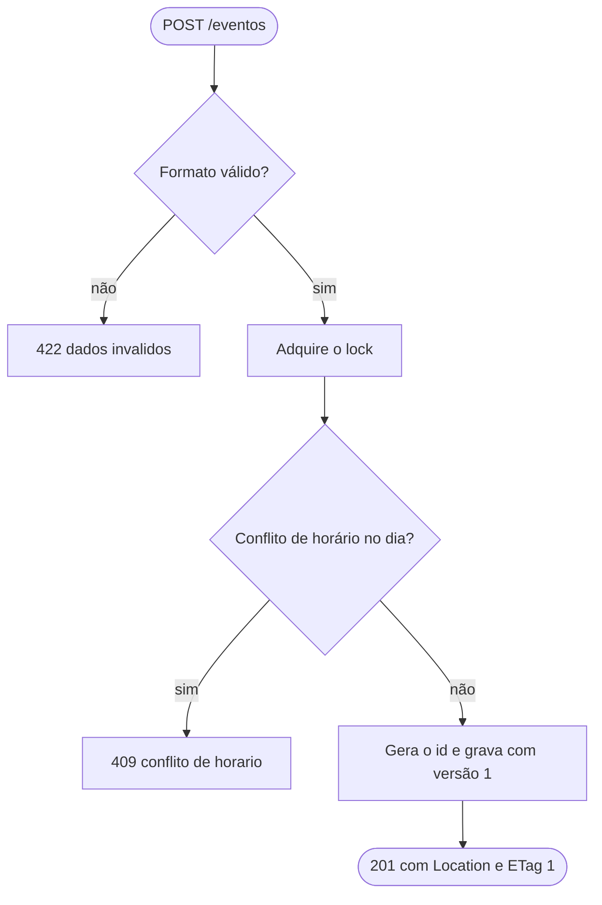
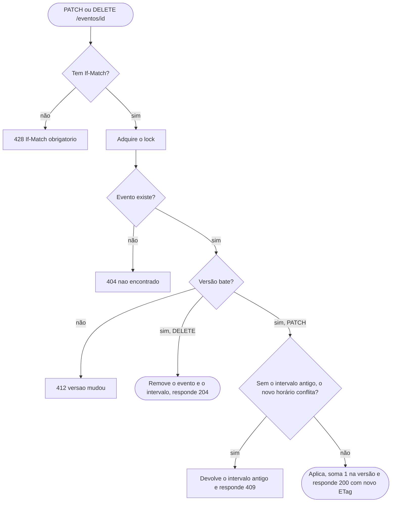
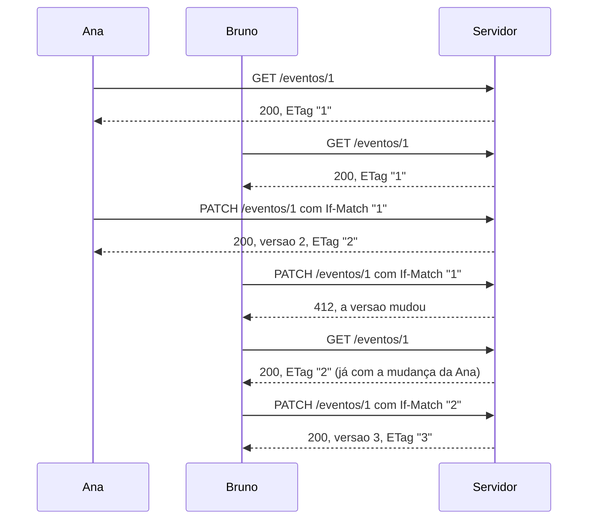

# Diagramas de negócio da agenda compartilhada (Equipe 02)

Estes diagramas mostram as regras de negócio da agenda: como um evento é criado e como fica a edição e a remoção que vão entrar na Entrega 2. Em todos eles, do momento em que o lock é adquirido até a resposta, nenhuma outra requisição mexe na agenda. Qualquer saída depois desse ponto (sucesso ou erro) libera o lock.

## Criar evento (`POST /eventos`)

Antes de qualquer coisa o Pydantic valida o formato. Só depois o servidor pega o lock e procura conflito de horário naquele dia. Assim, se duas pessoas tentam o mesmo horário ao mesmo tempo, a segunda já encontra o evento da primeira gravado e recebe 409.

## Editar ou remover evento (Entrega 2)

O `If-Match` é conferido antes do lock porque não depende do estado da agenda. No `PATCH`, o intervalo antigo do evento sai do índice antes da busca por conflito. Se não fosse assim, o evento conflitaria com ele mesmo ao mudar só um pouco de horário. Se der conflito, o intervalo antigo volta para o índice e nada muda.

## Exemplo: Ana e Bruno editando o mesmo evento

É o caso que o lock sozinho não resolve, porque entre ler e salvar passa tempo e cada passo é uma requisição separada. Os dois leem a versão 1. Ana salva primeiro, e o evento passa para a versão 2. Quando Bruno tenta salvar em cima da versão 1, recebe 412 em vez de apagar a alteração da Ana sem saber. Ele relê o evento e tenta de novo.

